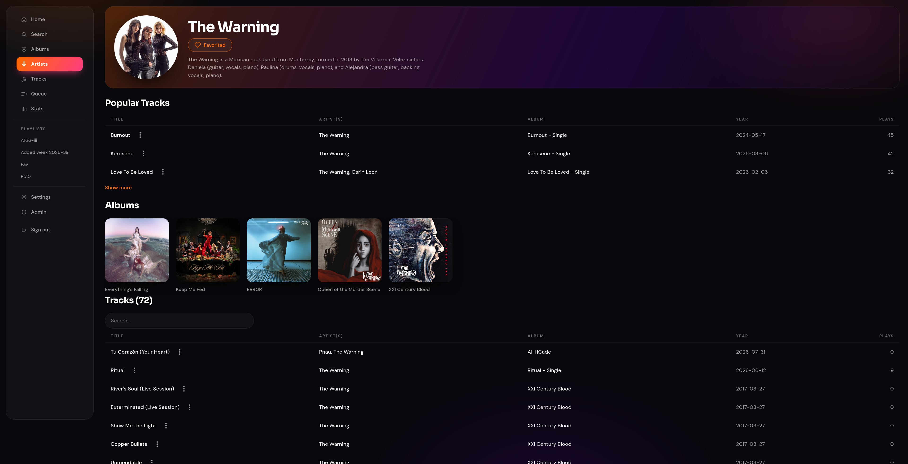
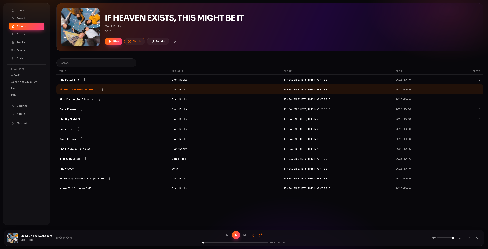
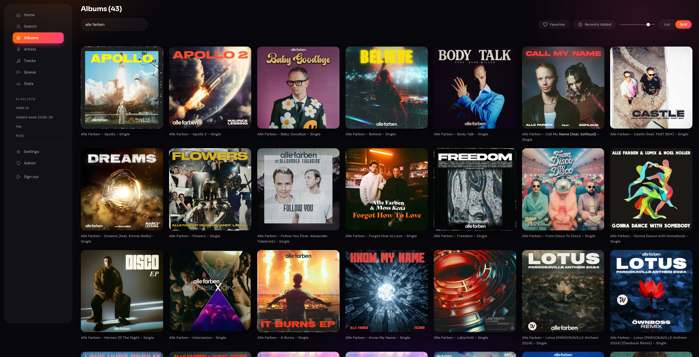
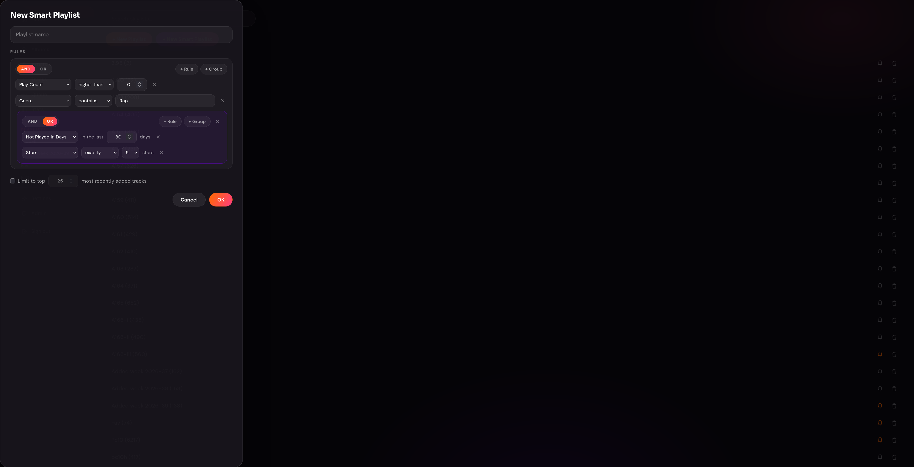

[](https://github.com/dijssel30/Plaat/actions/workflows/build-and-test.yml)

## About The Project

Plaat is self hosted music streaming service for your own music collection.

Features:
- Support for most music formats
- Works on Linux and Windows
- A mobile app to stream your collection on your phone
- Add multiple user profiles
- automatically scan folders for new music
- Automatically reconvert files if they are of unsupported format like ALAC
- Keep track of play counts
- Create smart playlists based on complex rules


## Screenshots





## Getting Started

### Prerequisites

The Dotnet 10 SDK needs to be installed on your system to build the solution. FFmpeg needs to be installed on the system running the Plaat.Api application.

### Building

```bash
dotnet build                                   # build whole solution (Plaat.slnx)
dotnet test                                    # run all test projects
dotnet run --project Plaat.Api                 # run the API
dotnet run --project Plaat.Frontend            # run the Blazor frontend (expects the API reachable at PlaatBackendOptions:BaseUri)
```

### Installation

Both the Plaat.Api and Plaat.Frontend project need to be build and running to use Plaat.
See the deploy folder for an example how to build and use the application.
On first use, update the default password of the Admin user.

### Set-up

Some useful settings you may want to edit in the Appsettings:

API:
- **Swagger:Enabled** Change when you don't want Swagger to be enabled. If you only want it to be accessible from some networks, you can set **Swagger:AllowedNetworks**. The default production setting is to allow Swagger only from local networks.
- **PlaatOptions:ImagesStoragePath** Folder the album covers end up
- **PlaatOptions:TargetReconvertedPath** Folder reconverted music files end up
- **ConnectionStrings:SqlLiteConnection** Specify a custom connection string for your sqlite database
- **PlaatOptions:JwtOptions:Key** (Required) Key for signing the authentication tokens.
